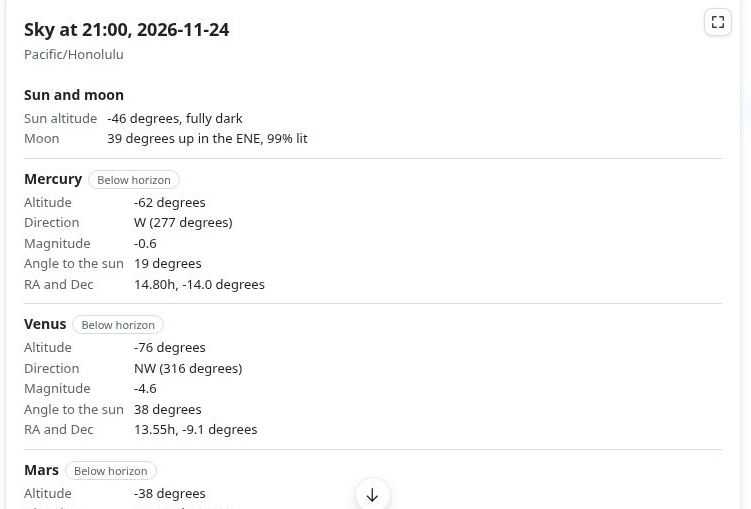
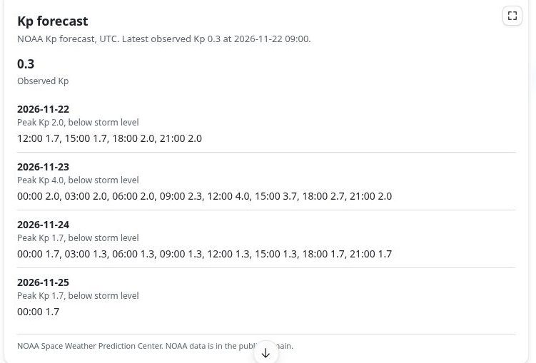
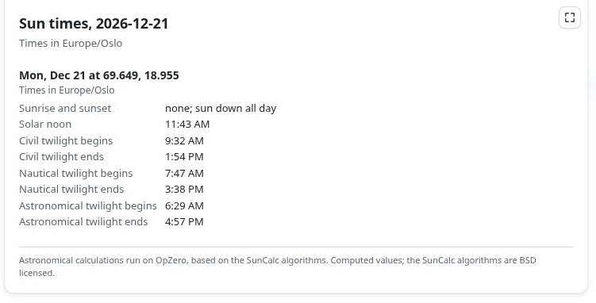

# Night Sky

Choose a time to head outside. Night Sky combines naked eye planet positions, meteor shower peaks, local darkness, and moonrise with NOAA space weather when the target is the aurora.

[Connect with Claude, ChatGPT, Muse Code, or Grok](PROVIDERS.md)

## Try it

- Find a moon free hour to look for planets in Flagstaff this weekend. Which direction should I face?
- Which of the next two nights looks better for an aurora outing near Fairbanks?

## Install in Claude

In Claude Code, run the following commands.

```text
/plugin marketplace add OpZero-sh/plugins
/plugin install night-sky@opzero
```

In Claude chat or Cowork, open the installed plugin’s **Connectors** tab and connect the listed services. The hosted services use public data and require no sign in. Then ask a question or name a skill.

## Skills

Each skill is a set of written instructions that Claude loads when a request matches it. Reference notes sit beside each skill and are read only when needed.

- `observing-plan` plans a night of stargazing or planet viewing: when full darkness starts, which of the five naked eye planets are up, where to look, and how much the moon interferes.
- `meteor-watch` lists the major annual meteor showers with peak dates and moon brightness, then works out the dark hours on the peak night for your site.
- `aurora-watch` reads the NOAA Kp forecast and the outlook for your location, converts the forecast from UTC to your local time, and checks it against local darkness. It also reads NOAA space weather alerts on request.
- `sun-moon-times` answers plain questions about sunrise, sunset, golden hour, twilight, day length, moonrise, moonset and moon phase.

## Agent

In Cowork or Claude Code, the `viewing-window` agent compares several nights, times or sites for one target and returns them side by side with a pick. It can call only the nine read only tools of the three services listed below.

This plugin has no hooks and runs no code on your machine.

## Sources and coverage

Solar and lunar times and planet positions are calculated for the observing site and are approximate, good to about a degree. Planet coverage is Mercury, Venus, Mars, Jupiter and Saturn. Meteor showers are the ten major annual showers, with peak dates that can shift by a day. Aurora guidance uses the NOAA Space Weather Prediction Center planetary Kp forecast, which reaches about three days ahead and is a rule of thumb, not a guarantee. Cloud cover, terrain, and light pollution require separate local information.

For decisions that depend on space weather, such as radio or power operations, use the [NOAA Space Weather Prediction Center](https://www.swpc.noaa.gov/) directly.

## What this plugin runs, sends and fetches

The plugin connects Claude to three hosted services over HTTPS. A request carries only what the question needs: a latitude and longitude, a date, a clock time and a time zone name. The services state that requests are not stored.

- [night-sky-tonight](https://night-sky-tonight.mcp.opzero.sh/) at `night-sky-tonight.mcp.opzero.sh` · [Privacy](https://night-sky-tonight.mcp.opzero.sh/?page=privacy) · [Support](https://night-sky-tonight.mcp.opzero.sh/?page=support)
- [sun-and-moon](https://sun-and-moon.mcp.opzero.sh/) at `sun-and-moon.mcp.opzero.sh` · [Privacy](https://sun-and-moon.mcp.opzero.sh/?page=privacy) · [Support](https://sun-and-moon.mcp.opzero.sh/?page=support)
- [aurora-forecast](https://aurora-forecast.mcp.opzero.sh/) at `aurora-forecast.mcp.opzero.sh`, which reads the forecast and alerts from NOAA · [Privacy](https://aurora-forecast.mcp.opzero.sh/?page=privacy) · [Support](https://aurora-forecast.mcp.opzero.sh/?page=support)

The repository also holds configuration files for other clients: `integrations/grok-servers.json` and the `integrations/openai` folder. The plugin never uses them and they are not programs.

The two scripts that read them are not in this repository. They are in the catalog repository, [OpZero-sh/plugins](https://github.com/OpZero-sh/plugins), and do something only if you clone it and run them yourself.

- `tools/build_openai.py` reads the skills, the license, the product icon and the `integrations/openai` folder from a checkout of this repository and writes ZIP packages to the folder you name. It makes no network request.
- `tools/grok_example.py` reads `integrations/grok-servers.json` and prints a request preview when run with `--dry-run`. Without that flag it reads `XAI_API_KEY`, and `XAI_MODEL` if set, from your environment and sends your question and the three service URLs to the xAI API at `api.x.ai`.

## In use

Examples from the connected services in Claude.






